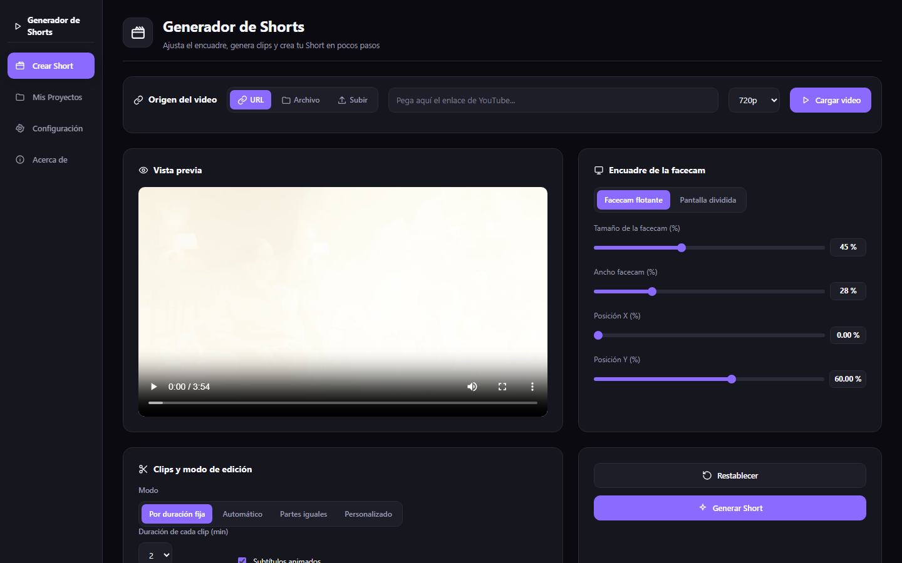
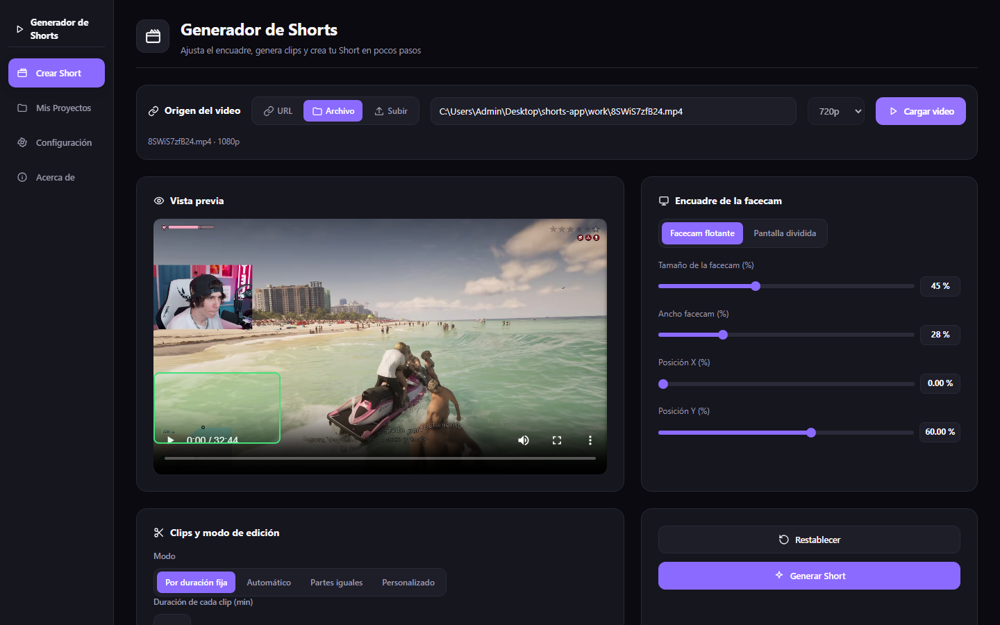
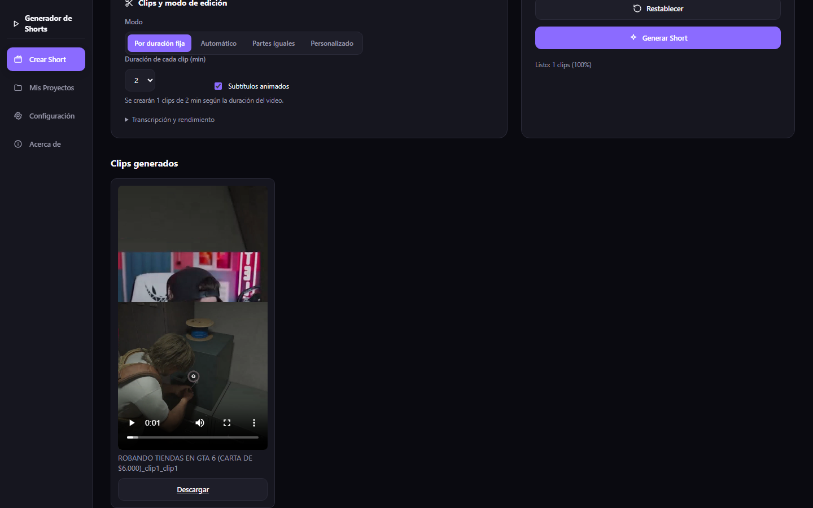

# 🎬 Short YT Creator

**Turn a long video into vertical 9:16 clips with a facecam overlay — fast, lightweight, and without framework bloat.**

## See it in action

## How to use

1. Paste a YouTube URL or choose **Subir**, pick the download quality, then press **Cargar video**.
2. Move the sliders to place the facecam square while watching the preview.
3. Choose a clip mode and duration (1–4 minutes), then press **Generar Short**.
4. Play or download each clip from the results grid.

## Run it

On Windows, double-click **`iniciar.bat`**. It installs dependencies on first run, starts the server, opens the browser at `http://localhost:8502`, and leaves a visible console with logs.

To stop it, close the console window. After 10 minutes without activity the service pauses and the page offers a **Reactivar servicio** button.
